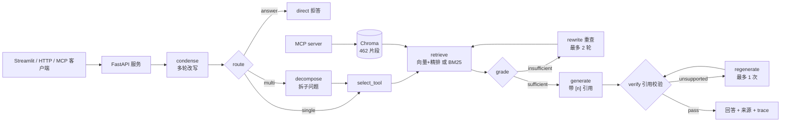

# FastAPI 中文文档 Agentic RAG 服务

面向 FastAPI 中文文档的检索增强问答服务：**LangGraph 状态机**负责编排，**向量 + BM25 双工具**负责检索，**FastAPI + SSE** 对外提供服务，**MCP server** 把检索能力暴露给其他 Agent 客户端。

- 语料：FastAPI 官方中文文档 115 篇 / 462 个片段（MIT，见 `corpus/NOTICE.md`）
- 模型：`text-embedding-v4` + `gte-rerank-v2` + `qwen-plus`（阿里云百炼）
- 评测：同一套 50 题，比较检索基线 C 与 Agent 化的 D1–D4，所有数字来自实际运行
- 入口：Streamlit 问答页、HTTP API、MCP stdio server

## 架构



离线部分沿用原有入库链路：Markdown 清洗 → 1000 字切分（重叠 100）→ `text-embedding-v4` → Chroma；BM25 索引直接建在同一批 chunk 上，保证两个工具返回的 `chunk_id` 一致。

## 评测结果

50 题：20 单跳 / 15 口语 / 10 多跳 / 5 域外。C 是旧检索基线，D1–D4 每组只增加一个变量。

| 指标 | C 基线 | D1 路由+重查 | D2 多跳拆解 | D3 +BM25 | D4 +引用校验 |
| --- | --- | --- | --- | --- | --- |
| hit@5 | 0.956 | 0.956 | **0.978** | **0.978** | **0.978** |
| MRR@5 | 0.854 | 0.856 | 0.854 | **0.865** | **0.865** |
| 多跳 hit@5 | 0.80 | 0.80 | **0.90** | **0.90** | **0.90** |
| 域外拒答 | 5/5 | 5/5 | 5/5 | 5/5 | 5/5 |
| 域内误拒 | 0/45 | 0/45 | 0/45 | 0/45 | 0/45 |
| 引用命中率 | 0.956 | 0.911 | 0.933 | 0.933 | 0.933 |
| 平均 LLM 调用 | — | 2.56 | 2.80 | 2.74 | 3.74 |
| 端到端均值 | — | 3.77 s | 4.18 s | 4.18 s | 4.98 s |

- D2 的收益最大：多跳题从 0.80 提到 0.90。
- D3 的 BM25 主要改善排序：口语题 MRR 0.917 → 0.95；13 道题走 BM25 且全部命中，平均检索 6.4 ms，向量+精排为 926 ms。
- D4 的引用校验不改变检索指标，每题多 1 次 LLM 调用；50 题触发 2 次重生成，1 次修好，1 次保留 `unsupported` 标记。
- 消融细节、失败分析与成本权衡见 `eval/report_agent.md`。

## 快速开始

```bash
conda create -n rag python=3.10 -y && conda activate rag
pip install -r requirements.txt

cp .env.example .env          # 填入 DASHSCOPE_API_KEY
python -m corpus.fetch        # 首次：下载语料（仓库已带语料时可跳过）
python -m corpus.ingest --reset
```

启动服务与客户端：

```bash
uvicorn service.api:app --host 127.0.0.1 --port 8000   # API
streamlit run app_qa.py                               # 问答页 http://localhost:8501
streamlit run app_file_uploader.py                    # 上传页 http://localhost:8502
```

Streamlit 不直接加载模型和向量库，只通过 `service_client.py` 调 FastAPI；API 没启动时侧边栏会提示。

### HTTP API

```bash
curl -X POST http://127.0.0.1:8000/chat \
  -H "Content-Type: application/json" \
  -d '{"question":"怎么给一组接口统一加鉴权？","session_id":"demo1"}'
```

`/chat` 返回答案、来源、引用编号、route / grade / verify 状态、节点级 trace 和成本指标。

```bash
curl -N -X POST http://127.0.0.1:8000/chat/stream \
  -H "Content-Type: application/json" \
  -d '{"question":"依赖注入里 yield 和 return 有什么区别？","session_id":"demo1"}'
```

SSE 事件依次为 `start` → 多个 `node` → `final`；出错时是 `error`。节点事件带节点名、耗时和简短说明，前端据此显示进度。

其他接口：

- `GET /health`：Chroma / BM25 / 会话存储状态，不返回任何密钥
- `GET /trace/{request_id}`：最近 10 分钟的请求级 trace
- 配置 `SERVICE_API_KEY` 后，`/chat`、`/chat/stream`、`/trace` 需要 `X-API-Key`

### MCP server

```bash
python mcp_server.py
```

在支持 MCP 的客户端里配置 stdio 启动方式：

```json
{
  "mcpServers": {
    "fastapi-docs-rag": {
      "command": "<python 解释器绝对路径>",
      "args": ["<项目绝对路径>/mcp_server.py"],
      "env": {"PYTHONIOENCODING": "utf-8"}
    }
  }
}
```

暴露两个工具：

- `search_docs(query, k)`：语义召回 + `gte-rerank` 精排
- `bm25_search(query, k)`：jieba 分词 + BM25 关键词检索

工具只做检索，不调用生成模型；问答编排仍由 FastAPI 负责。

## 关键设计

- **状态机而不是“多 Agent”**：11 个节点各做一件事，条件边控制重查与校验回路，轮次有上限，轨迹可逐节点回放。没有为了“多 Agent”而引入 AutoGen/CrewAI。
- **重查只换召回问法**：`search_query` 与 `standalone` 分离，改写句只影响召回，精排始终围绕补全后的原问题，避免重查把上一轮已覆盖的文档挤掉。
- **多跳保留原问题一路召回**：拆解是增量，不替代原问题；假多跳不会再丢单跳能命中的片段。
- **来源兜底有闸门**：只有精排结果集中在 ≤2 个来源时才补来源，防止兜底片段挤掉本来已命中的内容。
- **BM25 置信度级联**：所有召回 query 的 BM25 最高分都 ≥ 30 才跳过向量检索，否则走向量+精排；没有做并集融合，因为实测会带偏多跳精排。
- **引用校验分两层**：越界编号直接删掉，不交给模型；结论是否有资料支撑交给温度为 0 的裁判模型，不通过只重生成一次，仍不通过保留答案并标记 `unsupported`，不整题拒答。
- **会话存储可切换**：文件 / Redis 同一接口，Redis 连不上自动降级为文件；降级原因只记录异常类型，不把连接串写进日志或接口。
- **限流与 trace 是进程内实现**：单实例够用；多副本时要换 Redis 才能做全局限流和跨实例 trace，这一点在代码注释里写明，没有假装是分布式实现。

## 目录结构

```
.
├── agent/
│   ├── graph.py            # LangGraph 节点注册与条件边
│   ├── nodes.py            # 改写、路由、拆解、检索、自检、生成、校验、重生成
│   ├── prompts.py          # 各节点提示词
│   ├── runner.py           # 依赖组装、同步问答、SSE 事件流
│   ├── sessions.py         # 文件 / Redis 会话存储
│   ├── state.py            # 图状态与对外 Answer 结构
│   └── tools.py            # 向量、BM25、分词、来源兜底
├── service/
│   ├── api.py              # FastAPI 应用、SSE、健康检查、trace
│   ├── schemas.py          # 请求 / 响应模型
│   ├── rate_limit.py       # 进程内滑动窗口限流
│   └── trace_store.py      # 进程内 TTL trace
├── service_client.py       # Streamlit 调 API 的 HTTP 客户端
├── mcp_server.py           # MCP stdio server（search_docs / bm25_search）
├── app_qa.py               # Streamlit 薄客户端
├── app_file_uploader.py    # 文档上传页
├── config_data.py          # 路径、模型、检索与服务参数
├── knowledge_base.py       # 切分、稳定 chunk_id、幂等入库
├── vector_stores.py        # 向量检索与统一 Hit 结构
├── rerank.py               # gte-rerank 精排，失败降级
├── rag.py                  # 旧链路（保留用于 C 组基线复现）
├── eval/                   # 50 题评测集、A/B/C 与 D1–D4 脚本和报告
└── tests/                  # 服务层、会话存储、MCP 工具测试
```

## 测试

```bash
pytest tests -q
```

16 个测试不依赖真实大模型和 Redis：用假 LLM / 假检索器 / FakeRedis 验证 HTTP 行为、限流、鉴权、SSE 事件、会话裁剪与 TTL、MCP 工具返回结构，以及语料清洗不误删 Jinja 示例。

真实链路做过两次冒烟：

- `uvicorn` + `curl`：`/health`、`/chat`（多跳题 8 次 LLM、10.5 s）、`/chat/stream`（9 个事件、4.0 s）、`/trace`
- Streamlit `AppTest` 跑真实脚本：无异常，回答与 5 条来源正常渲染
